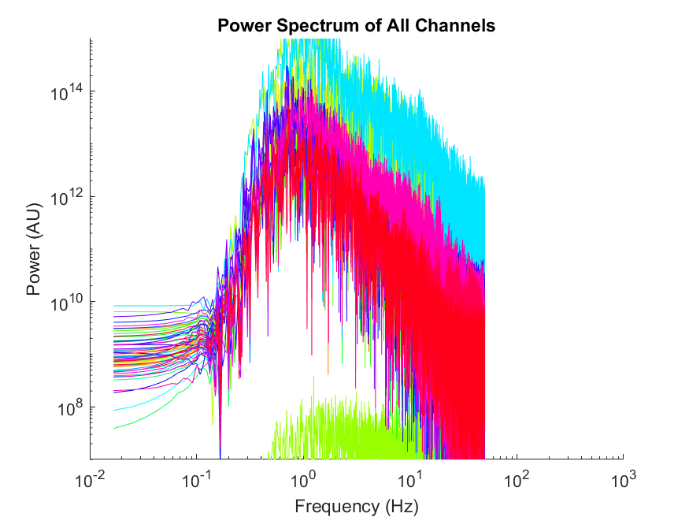
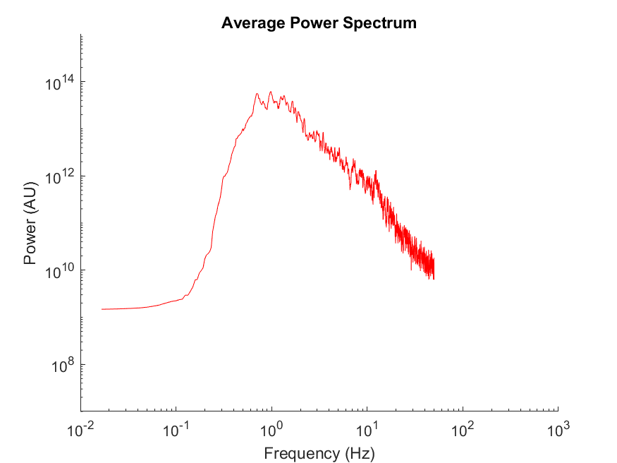
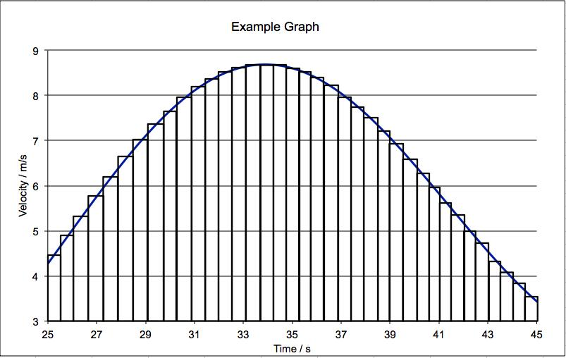
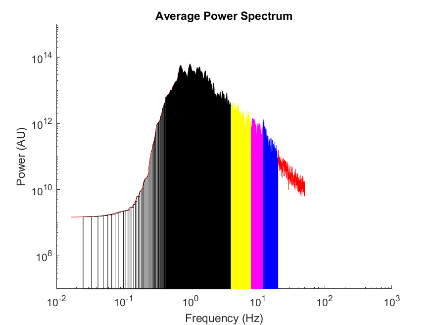

# Power Spectrum Analysis Pipeline Overview

## Data Reading

Raw MEA data is read from a HDF5 (.h5) file using MATLAB's McsMatlabDataTools add on. We are only interested in the data recorded in a 2 minute window, so we discard all data before 120s and after 240s, leaving 2 minutes worth of data to be analyzed. We chose this time span because the first two minutes of recordings are vulnerable to having data skewed by the fact the culture was recently disturbed. Beyond 240s, the culture will typically "settle down", making the last minute contain very little insightful data. 

## Filtering

Our next step is to filter the data for basic noise reduction. We use a Butterworth fourth order bandpass filter design which will allow through data in the domain of [0.02 Hz, 200 Hz]. We choose to filter out other frequencies because data above 200 Hz is used in spike detection, which is not of concern for this lower frequency band analysis.

## Fourier Transform and Power Spectrum

The Fourier Transform of a dataset is the representation of the data as a composition of frequencies. The Fourier space is useful because it allows for more time and space efficient computations, and ways of analyzing data. 

An element in the Fourier transform, $X$, of a dataset $x$ can be found with

$X_k=\sum_{n=0}^{N-1}{x_n\cdot e^{-i2\pi\frac{k}{N}n}}$

Where

- $X_k$ is some element in the Fourier space, $X$
- $x_n$ is some element in the original data recording, $x$ 
- $N$ is the total number of samples in the dataset (the number of elements in $x$)

### Magnitude Spectrum

We then modify the Fourier domain. We are only interested in the magnitude, not the sign of the amplitude, so we take the absolute value of all Fourier domain values. Because the Fourier space is symmetrical, it is safe and more efficient to discard half of the Fourier data. Doing this however requires doubling the remaining frequencies, since otherwise the magnitude contributed by the other half would be lost[[1]](#the-fourier-space-is-symmetrical-meaning-the-first-half-of-our-fourier-values-are-a-mirror-image-of-the-latter-half-this-means-that-if-we-throw-away-half-of-the-data-we-can-still-do-all-the-computations-and-analyses-just-as-well-since-we-know-exactly-what-the-discarded-half-looks-like-it-is-reccomended-to-do-this-simply-because-it-is-twice-as-fast-to-work-with-half-as-much-data-since-the-discarded-half-of-the-data-contributes-to-the-spaces-total-magnitude-it-is-best-practice-to-double-the-values-in-the-remaining-half-of-the-data-to-accomodate-the-lost-magnitudes). Finally, we divide all values in the Fourier domain by the number of samples, in order to normalize the data[[2]](#the-values-in-the-fourier-domain-scale-with-the-number-samples-in-the-dataset-this-means-that-recordings-with-more-data-would-have-greater-values-in-the-fourier-domain-irrelevant-of-the-actual-values-of-those-samples-to-fix-this-we-divide-by-the-number-of-samples-because-the-fourier-domain-scales-linearly-with-the-number-of-samples).

So, an element of our modified Fourier tansform, or the magnitude spectrum, is found with

$M_n=\frac{2}{N}\cdot |X_n|$

And the whole magnitude spectrum is simply $M=[M_0, M_1, M_2, ..., M_\frac{N}{2}]$.

### Power Spectrum

Because we are interested in measuring power, as opposed to simple magnitude, we square the values in the magnitude spectrum, to find the desired power spectrum, $P$. This is done because power is proportional to the square of amplitude in the Fourier domain[[3]](#the-raw-mea-recordings-contain-voltages-picked-up-from-the-electrodes-in-the-mea-a-more-useful-metric-for-our-analysis-mainly-because-it-allows-for-analysis-of-frequency-bands-in-the-fourier-domain-in-real-valued-space--by-paresevals-theorem-we-know-that--can-be-found-by-squaring-the-fourier-transform-which-is-desireable-for-speed-and-because-our-analysis-will-inspect-frequency-bands-in-the-fourier-space)[[4]](#parsevals-theorem-states-the-sum-or-integral-of-a-functions-square-is-equal-to-the-sum-or-integral-of-its-fourier-transform). So, 

$P=M^2$

This power spectrum, $P$, represents the activity in the neuron culture at each channel, and is used to produce the figures seen in this analysis pipeline.

## Averaging Recordings

So far, we have taken the recordings from all 60 electrodes in the MEA, and converted the raw data into a power spectrum in the Fourier space, for each of the 60 channels. Plotting this data directly will produce a figure similar to this:

> <small>Figure 1: Power spectra from all channels plotted together.[[5]](#to-make-the-data-most-presentable-our-data-is-plotted-on-a-logarithmic-scale-on-both-the-vertical-and-horizontal-axes-the-arbitrary-power-units-on-the-vertical-axis-are-representative-of-the-fact-that-the-fourier-domain-does-not-represent-real-valued-numbers-real-by-the-mathematical-definition-we-cut-off-data-below-002-hz-and-above-50-hz-there-is-not-any-significant-data-to-speak-of-belo-002-hz-because-the-bandpass-filtering-diminishes-this-region-and-there-is-significant-noise-from-em-interference-in-ranges-above-50-hz-all-data-shown-in-this-overview-is-taken-from-data-from-n102512-plate-39070-div7)</small>
> 

This data is difficult to interpret. The lines from all channels overlap each other, and make the plot difficult to read. And outliers often exceed or fall short of the y axis used to plot the more average channel readings. Furthermore, for the area calculation we perform later, it would be quite unhelpful to analyse and compare data from 60 different channels from each recording. 

We need to combine all the channels into one power spectra. We do this by simply averaging the values across each channel into one average power spectrum, $O$. Recall that to average

$O=\frac{\sum_{n=0}^{N-1}{P_n}}{N}$, where $N$ is 60, the total number of recording channels.

We take the average power spectrum, and apply a moving average filter to slightly smooth the average values. A window size of 10 was used, because it effectively removed residual noise from the average curve, without dramatically smoothing out the curve's features. The filtered average, $O'$, is found with

$O'_i=\frac{1}{w}\sum_{k=-\frac{w-1}{2}}^{\frac{w-1}{2}}{O_{i+k}}$

for all $i$ where the window fits inside the data[[6]](#at-the-edges-of-the-dataset-the-window-may-not-fit-for-example-with--10-we-cannot-use-this-formula-for--because--so-the-window-does-not-actually-fit-at-this-part-of-the-data-for-our-implementation-the-edges-are-handled-by-shrinking-the-window-to-fit-the-edge-values-which-was-accomplished-by-using-the-movmean-command-in-matlab). $w$ is 10, the size of the smoothing window used.

Plotting the smoothed average data results in a much more pleasant graph, which we can use for more meaningful analysis of the recording as a whole. 

> <small>Figure 2: Filtered average power spectrum.[[5]](#to-make-the-data-most-presentable-our-data-is-plotted-on-a-logarithmic-scale-on-both-the-vertical-and-horizontal-axes-the-arbitrary-power-units-on-the-vertical-axis-are-representative-of-the-fact-that-the-fourier-domain-does-not-represent-real-valued-numbers-real-by-the-mathematical-definition-we-cut-off-data-below-002-hz-and-above-50-hz-there-is-not-any-significant-data-to-speak-of-belo-002-hz-because-the-bandpass-filtering-diminishes-this-region-and-there-is-significant-noise-from-em-interference-in-ranges-above-50-hz-all-data-shown-in-this-overview-is-taken-from-data-from-n102512-plate-39070-div7)</small>
> 

## Area Under the Average Curve

### Rectangle Method for Integration

In mathematics, the area under a curve, a.k.a. the integral of a curve, is often used as a metric of how big the curve is. In other words, a curve with a large area can fit a lot inside that area. In our case, since we measure power on the vertical axis, for discrete frequencies on the horizontal axis, the area under our curve essentially represents the amount of power expressed in the MEA recording, across all frequencies. 

The area under a continuous curve can be calculated exactly as

$A=\int_{b}^{a}{xdx}$, where $a$ and $b$ are the starting and ending bounds for integration, respectively.

However, our curve is not continuous, it is made from discrete values, i.e., individual data points along the horizontal axis, connected by a line. For discrete datasets, the area under a curve must neccesarily be approximated[[7]](#for-curves-made-from-discrete-data-there-could-theoretically-be-variation-in-the-true-data-between-any-two-points-ie-if-the-sampling-frequency-is-too-low-to-catch-some-feature-of-the-data-that-feature-would-not-be-represented-in-the-discrete-dataset-hence-for-discrete-data-all-integration-is-inherently-approximate-this-is-not-concerning-however-the-integration-methods-used-provide-accurate-approximations-and-our-sampling-frequency-is-high-enough-that-major-deviations-are-highly-unlikely), which can be done using the rectangle method for integration. 

The idea behind the rectangle method for integration is that the area of an individual rectangle is $A_r=w_r\cdot h_r$. So, we can place ar rectangle at some point $r$ on the horizontal axis. The rectangle's width will be the distance between two data points, and its height will be the height of the curve at that point. Then, the area of the rectangle at $r$ will be rougly equal to the are covered by the curve between the points $r$ and $r+1$. If we place such rectangles at every point $r$ in the data set, we will have an approximation of the curve's area at every discrete point. Summing these rectangle areas together will yield the approximate area under the entire curve[[8]](#the-rectangle-method-can-actually-yields-an-exact-approximation-but-only-for-continuous-curves-that-could-fit-infinite-rectangles-so-again-for-our-discrete-data-there-is-inherently-some-inaccuracy). Concisely, 

$w=\frac{\text{data end}-\text{data begin}}{N}$, This is the distance between two data points, the width of each rectangle.

$A\approx\sum_{r=0}^{N-1}{x_r\cdot w}$

Where $N$ is the number of discrete values in $x$. 

> Here is an example graph to help visualize what the rectangle method is doing with a curve:
>
> <small>Figure 3: visualization of the rectangle method for integration on a generic graph.</small>
> 
> 
> The areas of each discrete rectangle would be summed to find the total area under the curve.  

### Application of the Rectangle Method

As mentioned before, the area under a curve can be used to express "how much" of something is in the entire curve. We will be using area to inspect how much power is expressed in the MEA recording. 

The rectangle method does not have to be the area for the entire curve. For the generic curve above (Figure 3), suppose we removed all the rectangles below 30 and above 35. Then the remaining rectangles would approximate the area under the curve in the range [30 - 35]. This is usefult for us, because we would like to examine the power expressed in the sub gamma frequency bands, which are:

- Delta: 0.5 - 4 Hz
- Theta: 4 - 8 Hz
- Alpha: 8 - 12 Hz
- Beta: 12 - 20 Hz

So, we can take the area of rectangles from 0.5 - 4 Hz to find the power expressed in the Delta band, from 4 - 8 Hz for the power in the Theta band, and so on. 

Here is a visualization of the rectangles used for area calculations in our data:

> <small>Figure 4: visualization of the rectngle method in our data[[5]](#to-make-the-data-most-presentable-our-data-is-plotted-on-a-logarithmic-scale-on-both-the-vertical-and-horizontal-axes-the-arbitrary-power-units-on-the-vertical-axis-are-representative-of-the-fact-that-the-fourier-domain-does-not-represent-real-valued-numbers-real-by-the-mathematical-definition-we-cut-off-data-below-002-hz-and-above-50-hz-there-is-not-any-significant-data-to-speak-of-below-002-hz-because-the-bandpass-filtering-diminishes-this-region-and-there-is-significant-noise-from-em-interference-in-ranges-above-50-hz-all-data-shown-in-this-overview-is-taken-from-data-from-n102512-plate-39070-div7)</small>
> 
> 
> - The rectangles' colors represent which frequency band's area they contribute to. Black is delta, yellow is theta, pink is alpha, and blue is beta.  
> - The colored areas appear to have a solid color, because there are so many rectangles. Because there are so many, each individual rectangle is so thin that it is difficult to see its individual width. 
> - The rectangles at the left end of the graph appear wider because of the logarithmic scale used for the horizontal axis. On the logarithmic scale, the actual points in the lower portion of the data is plotted further apart, despite being just as far apart as higher ranges, which are plotted closer together. This makes the lower rectangles appear wider on the logarithmic plot, despite being just as wide as the other rectangles in the graph. 

## Footnotes

1. ##### The Fourier space is symmetrical, meaning the first half of our Fourier values are a mirror image of the latter half. This means that if we throw away half of the data, we can still do all the computations and analyses just as well, since we know exactly what the discarded half looks like. It is reccomended to do this simply because it is twice as fast to work with half as much data. Since the discarded half of the data contributes to the space's total magnitude, it is best practice to double the values in the remaining half of the data, to accomodate the lost magnitudes. 

2. ##### The values in the Fourier domain scale with the number samples in the dataset. This means that recordings with more data would have greater values in the Fourier domain, irrelevant of the actual values of those samples. To fix this, we divide by the number of samples, because the Fourier domain scales linearly with the number of samples. 

3. ##### The raw MEA recordings contain voltages picked up from the electrodes in the MEA. We want to inspect power, and we want to find the power in the frequency bands, which must be done in the Fourier domain. In real valued space, $P\propto V^2$. To quantify power, we will take the integral of our curve in the Fourier domain, so $\int{Fourier(P)df}$. By Parseval's theorem, $\int{V^2dt} = \int{Fourier(V^2)df}$. So, $\int{Pdt} = \int{Fourier(P)df}$

4. ##### Parseval's theorem states the sum or integral of a function's square is equal to the sum or integral of its Fourier transform. 

5. ##### To make the data most presentable, our data is plotted on a logarithmic scale on both the vertical and horizontal axes. The arbitrary power units on the vertical axis are representative of the fact that the Fourier domain does not represent real valued numbers ("real" by the mathematical definition). We cut off data below 0.02 Hz, and above 50 Hz. There is not any significant data to speak of below 0.02 Hz, because the bandpass filtering diminishes this region, and there is significant noise from EM interference in ranges above 50 Hz. All data shown in this overview is taken from Data from N102512, plate 39070, div7.

6. ##### At the edges of the dataset, the window may not fit. For example, with $w=10$, we cannot use this formula for $A_1$, because $1<\frac{w}{2}$, so the window does not actually fit at this part of the data. For our implementation, the edges are handled by shrinking the window to fit the edge values, which was accomplished by using the `movmean` command in MATLAB. 

7. ##### For curves made from discrete data, there could theoretically be variation in the "true" data between any two points. i.e., if the sampling frequency is too low to catch some feature of the data, that feature would not be represented in the discrete dataset. Hence, for discrete data, all integration is inherently approximate. This is not concerning however, the integration methods used provide accurate approximations, and our sampling frequency is high enough that major deviations are highly unlikely. 

8. ##### The rectangle method can actually yields an exact approximation, but only for continuous curves that could fit infinite rectangles. So again, for our discrete data there is inherently some inaccuracy. 